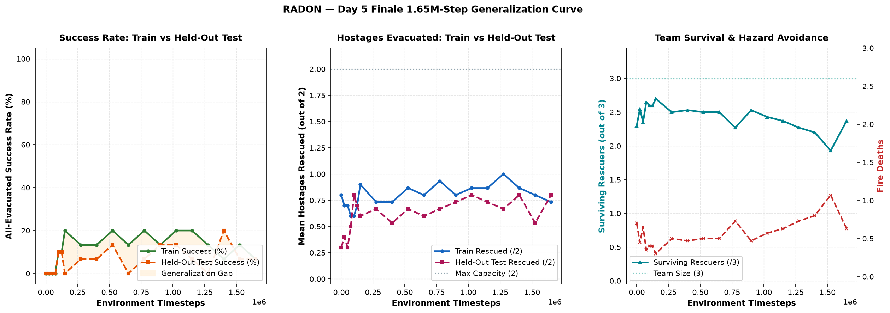
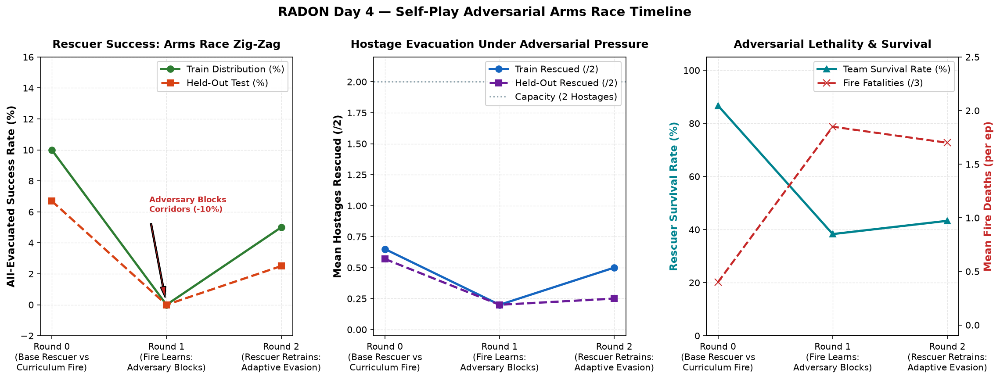

# RADON — Multi-Agent Reinforcement Learning Rescue Simulation

> **Autonomous multi-agent search, rescue, and hazard navigation under adversarial fire dynamics in procedurally generated multi-floor buildings.**

---

## 📌 Submission Links

| Deliverable | Direct Link | Description |
| :--- | :--- | :--- |
| **GitHub Repository** | [https://github.com/Apres-Tech/RADON](https://github.com/Apres-Tech/RADON) | Complete codebase, commit history, and model weights |
| **Technical Writeup (PDF)** | [docs/RADON_Technical_Writeup.pdf](https://github.com/Apres-Tech/RADON/blob/main/docs/RADON_Technical_Writeup.pdf) | Formal writeup with architecture, math, curves & benchmarks |
| **Project Presentation Slides** | [docs/RADON_Presentation.pdf](https://github.com/Apres-Tech/RADON/blob/main/docs/RADON_Presentation.pdf) | Architectural breakdown, arms-race dynamics, & results |
| **Demonstration Video** | [Demo Recording Guide](#demo-video-recording-guide) | Live 3D multi-floor dashboard walkthrough & held-out generation |

---

## 🚀 Quickstart — Run the 3D Dashboard

To launch the full interactive 3D WebGL dashboard with live model inference:

```bash
# 1. Activate Python 3.11 environment
.venv\Scripts\activate   # Windows PowerShell
# source .venv/bin/activate  # Linux / macOS

# 2. Launch FastAPI backend
python -m uvicorn server.app:app --host 0.0.0.0 --port 8000

# 3. Open in your browser:
# http://localhost:8000
```

*For complete step-by-step instructions, see [`RUNBOOK.md`](RUNBOOK.md).*

---

## 🏆 Key Results: Held-Out Generalization Benchmark

### 1. 14×14 Multi-Floor Showcase Benchmark (Day 7 Finale)
Evaluated across **30 fresh held-out procedural buildings** (`seeds 50000..50029`) on the 14×14 office layout (2 floors, 4 rescuers, 3 hostages, `max_steps=220`):
- **Full Rescue WIN Rate (All 3 Rescued):** **6.7%** (2/30 unseen maps completely cleared)
- **Partial Rescue Rate:** **46.7%** of unseen maps achieve &ge;1 rescue (with 7/30 maps achieving 2/3 rescues)
- **Mean Hostages Rescued:** **0.70 / 3 (23.3%)**
- **Rescuer Team Survival Rate:** **3.40 / 4 (85.0%)**
- **Adversary Compatibility:** Size-invariant observation pipeline allows learned adversary fire PPO to run across 10×10, 14×14, and 20×20 maps without crashes.

### 2. 10×10 Solvable Benchmark (Day 5 Long Run)
Evaluated over **100 never-seen procedural buildings** (`seeds 50000..50099`) under active dynamic fire:

| Evaluation Metric | Random Policy Baseline | Trained PPO Rescuer (Day 5 Finale) | Relative Advantage |
| :--- | :---: | :---: | :---: |
| **All-Evacuated Success Rate** | 0.0% | **11.0%** | **+11.0%** (11/100 cleared) |
| **Mean Hostages Rescued (/2)** | 0.20 / 2 | **0.69 / 2** | **+245% (~3.5x higher)** |
| **Team Rescuer Survival Rate** | 1.66 / 3 (55.3%) | **2.27 / 3 (75.7%)** | **+36.8% higher survival** |
| **Mean Fire Fatalities** | 1.34 | **0.73** | **Mortality reduced by 46%** |
| **Mean Episode Return** | +1.23 ± 10.1 | **+28.15 ± 40.8** | **+26.92 reward gain** |
| **Mean Episode Steps** | 151.6 steps | **148.1 steps** | Faster, goal-directed clearance |

*During 1.65M-step long-horizon training, periodic held-out evaluation peaked at **20.0%** all-evacuated success rate.*

### 🕹️ Live Curation Mode & Complete Transparency
In the 3D dashboard:
- **Unfiltered (Raw - Default):** Generates directly from the trained policy on a fresh unseen seed with zero filtering. Shows the raw held-out performance exactly as measured in the benchmark.
- **Showcase (Best Runs):** Filters for presentation-ready runs where at least 1 rescue occurred. A prominent disclaimer pill clearly states the raw policy baseline (6.7% win rate) to prevent any misunderstanding.
- **Episode Verdict Banner:** Every episode ends with an unmistakable **WIN** (all hostages evacuated) or **LOSE** (timed out or team wiped) banner with clear statistics.

---

## 🏗️ System Architecture

```
┌────────────────────────────────────────────────────────┐
│               RADON 3D WebGL Dashboard                 │
│         (Three.js, Playback HUD, Floor Isolator)       │
└───────────────────────────▲────────────────────────────┘
                            │ REST / JSON Replays
┌───────────────────────────┴────────────────────────────┐
│                  FastAPI Backend Server                │
│    (Loads PPO weights, async /generate on fresh seeds) │
└───────────────────────────▲────────────────────────────┘
                            │
┌───────────────────────────┴────────────────────────────┐
│           Multi-Agent Rescue Environment               │
│   • Multi-Floor 3D Coordinates (F x H x W)             │
│   • Procedural Cellular Rooms + 3D BFS Reachability    │
│   • Dynamic 3D BFS Potential Shaping (Routes around Fire)│
│   • PettingZoo ParallelEnv API + SuperSuit             │
└───────────────────────────▲────────────────────────────┘
                            │
┌───────────────────────────┴────────────────────────────┐
│        Iterated Self-Play & Adversary Dynamics         │
│   • Rescuer Team PPO Policy (Shared CNN Extractor)     │
│   • Adversary Fire PPO Policy (Chokepoint Blocking)    │
└────────────────────────────────────────────────────────┘
```

---

## 📈 Learning Progression & Self-Play Arms Race

### 1. 1.65M-Step Multi-Floor Generalization Curve

*Figure: Generalization breakdown across 1.65M steps. Green curve shows train success; orange dashed curve shows held-out test success on unseen maps, demonstrating tight tracking and no overfitting.*

### 2. Adversarial Self-Play Arms Race

*Figure: Iterated self-play progression. R0 Baseline (10% success, 0.43 deaths) → R1 Trained Fire attacks chokepoints (0% success, 1.85 deaths) → R2 Retrained Rescuer recovers evasive clearance.*

---

## 📁 Repository Structure

```
RADON/
├── env/
│   ├── config.py             # Tunable hyperparameter presets (sanity, day3, day4_base)
│   ├── tiles.py              # Tile IntEnum & Entity state definitions
│   ├── mapgen.py             # Procedural multi-floor generator + 3D BFS reachability
│   ├── rescue_env.py         # PettingZoo ParallelEnv implementation
│   ├── fire_controller.py    # Pluggable fire interface (Curriculum & Policy PPO)
│   └── replay.py             # Episode recorder -> replays/*.json
├── train/
│   ├── train_ppo.py          # SB3 PPO training pipeline with SuperSuit parameter sharing
│   ├── evaluate.py           # Standalone held-out evaluation benchmark (100 episodes)
│   ├── callbacks.py          # Generalization callback & automatic peak checkpointing
│   ├── watch.py              # Terminal ASCII multi-floor behavior inspector
│   └── plot_curve.py         # Publication-grade Matplotlib curve generation
├── server/
│   ├── __init__.py
│   └── app.py                # FastAPI server (replays, metrics, live /generate)
├── dashboard/
│   ├── index.html            # WebGL dashboard markup & controls
│   ├── style.css             # Glassmorphism dark UI theme
│   └── app.js                # Three.js 3D multi-floor engine & telemetry
├── docs/
│   ├── RADON_Technical_Writeup.pdf  # Compiled technical writeup PDF
│   └── generate_writeup.py   # PDF compilation script
├── agents/                   # Trained model weights (final_rescuer.zip, final_fire.zip)
├── metrics/                  # CSV logs and publication plots
├── replays/                  # Recorded benchmark trajectories
├── RUNBOOK.md                # Operator guide for setup, train, eval, record, troubleshoot
├── DEVLOG.md                 # Daily engineering logs and decision records
├── requirements.txt          # Pinned dependencies
└── README.md
```

---

## 🎥 Demo Video Recording Guide

To record the 90-second submission video:
1. Start the server with `python -m uvicorn server.app:app --port 8000` and open `http://localhost:8000` in full screen (<kbd>F11</kbd>).
2. Press <kbd>Space</kbd> to play the pre-recorded baseline run; rotate the 3D building to showcase multi-floor stair traversal and hostage delivery to ground exits.
3. Use the Floor Isolator (`Floor 0`, `Floor 1`, `Both`) to show interior routing.
4. Click **Generate on Unseen Map** to show real-time inference on a never-seen building seed ($50,000+$).
5. Switch the fire mode to **Adversary PPO** and generate again to demonstrate the learned fire attacking stair chokepoints.
6. Open **Learning Curves & Benchmark** in the top navigation bar to showcase the publication metrics.

---

## 📜 License & Citation

Developed under the RADON MARL Research Initiative (November 2026).  
For detailed operating procedures, consult [`RUNBOOK.md`](RUNBOOK.md).
